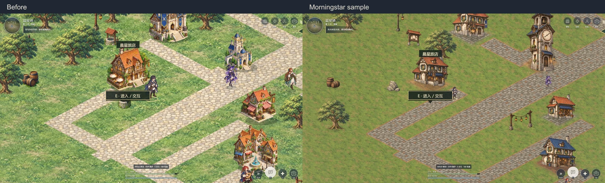
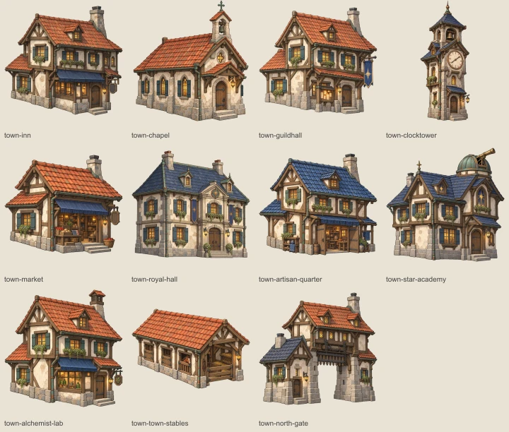
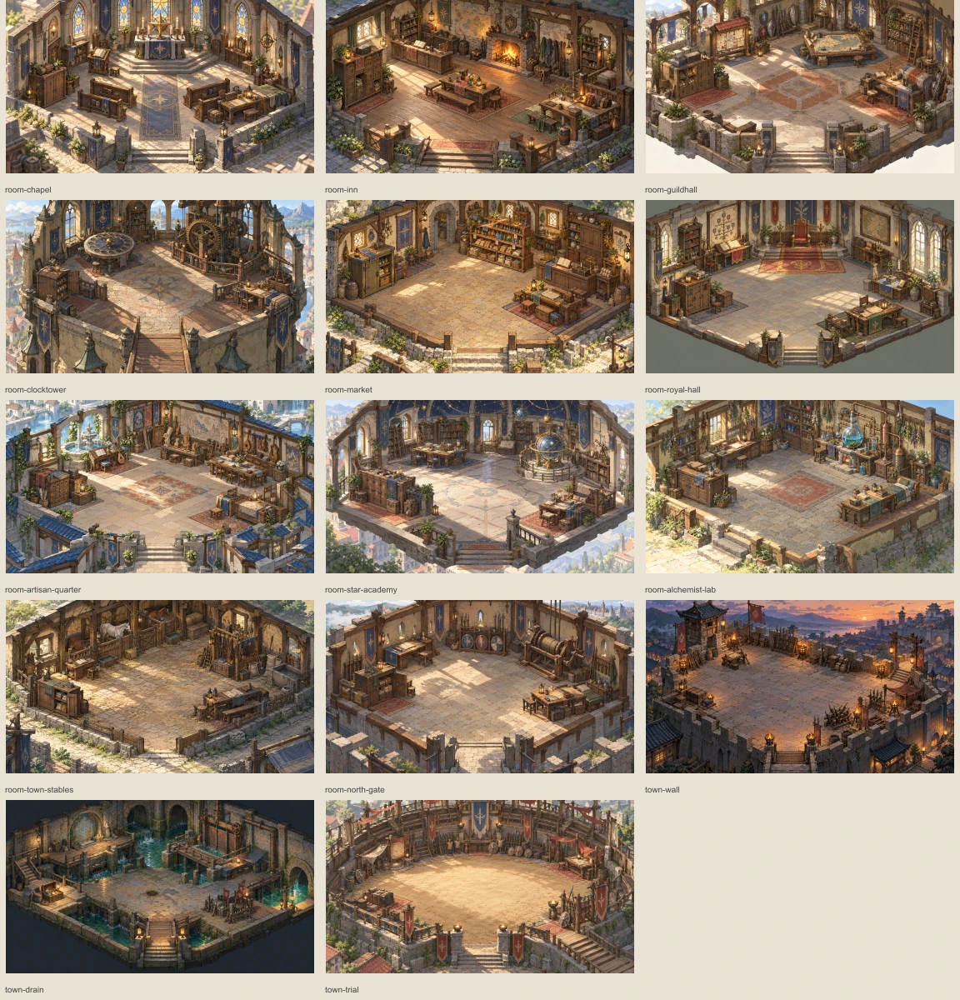
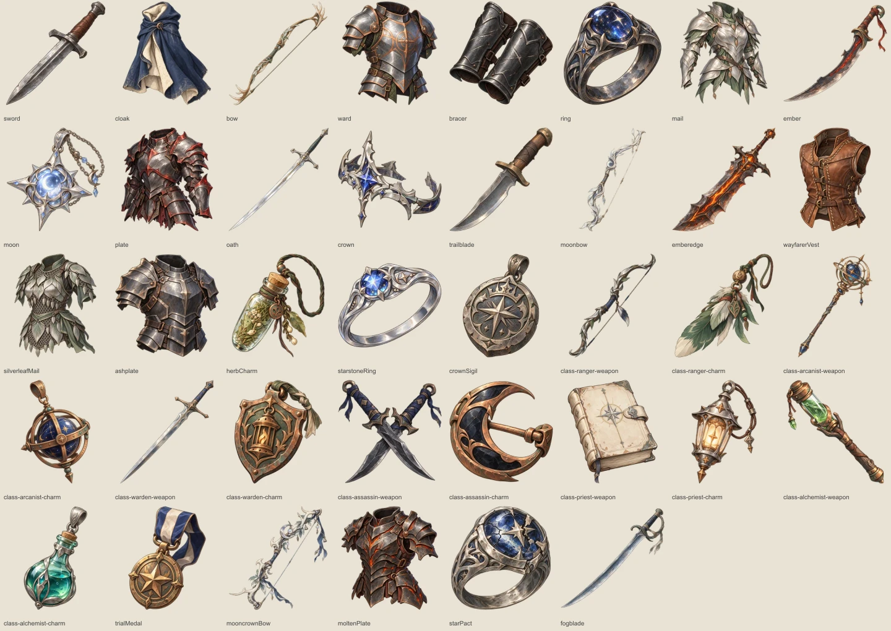
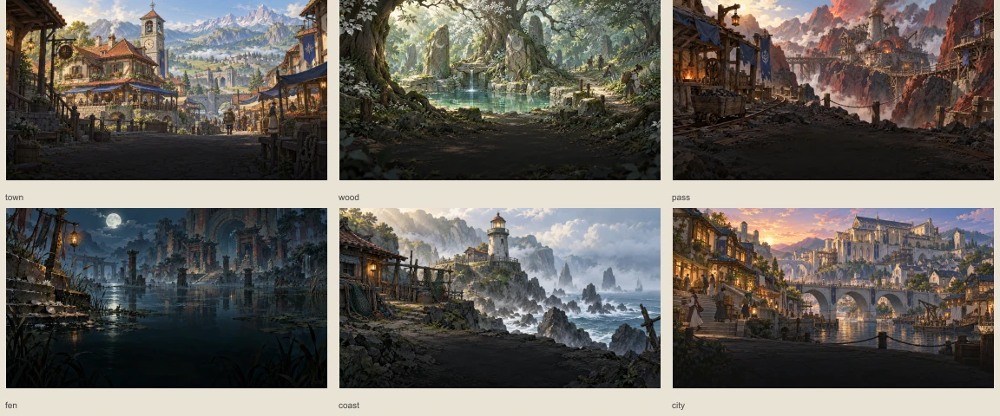
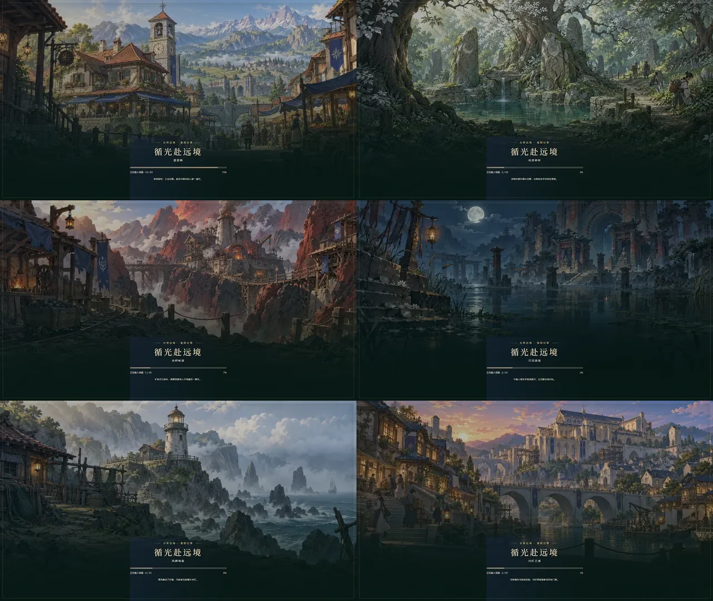

# 晨星镇样板：美术、装备与世界观验收

日期：2026-10-14。版本：7.2，存档继续使用 v6。本轮覆盖完整晨星镇；其他五区域保留原场景素材，六地均使用新的地方加载插画。

## 已交付

| 素材 | 数量 | 应用位置 |
|---|---:|---|
| 晨星镇专属建筑 | 11 | 室外、地标详情、世界记录 |
| 晨星镇环境物件 | 12 | 植被、井、货摊、物资、招牌、公告板与灯柱 |
| 地面材质 | 5 | 草、土、石路、砖地、碎石及边缘过渡 |
| 内室与冒险背景 | 14 | 11 个内室及城墙巡径、地下渠、公会试炼场 |
| 独立装备图标 | 38 | 背包、装备栏、制作、强化、交易与奖励 |
| 地方加载插画 | 6 | 六地室外、所属内室及冒险子地图 |

全部 86 项位图使用内置 imagegen 单独生成。原始 PNG 共约 160.4 MiB，保存在 `assets/art-v3/sources/`；运行 WebP 共约 16.1 MiB，按当前地图及打开的界面加载，不在标题预载全部资源。清单和准确字节数见 [资源统计](docs/art-v3/resources.json)。

提示词、风格说明和世界观分别见 [逐项提示词](assets/art-v3/prompts.json)、[制作说明](assets/art-v3/STYLE.md)、[世界观](assets/art-v3/WORLD.md)。`catalog.json` 记录原图、生成描述、参考图、运行路径、尺寸与锚点；`layouts.json` 记录最终家具占地、遮挡轮廓与交互位置。

## 实际行为

- 建筑保持原 ID、位置、占地与功能，新增晨星镇专属美术键。绘制保留图片真实宽高，接触阴影绘入地面缓存；道路及居民站位按新建筑实际入口朝向连接。其他五地的建筑、布局与素材保持原样。
- 土石边缘采用渐隐过渡，降低重复植被和灯柱密度；招牌挂在建筑立面。原人物素材保留，晨星镇室外调整尺寸，触控人物命中范围至少按 44px 目标计算。
- 14 张背景按最终绘景重新校准，家具地面多边形不可通行，遮挡按人物与家具前后关系绘制。所有内室、路线出口及交互点保持可达。
- 38 件装备各有专属图标，强化等级复用同一主体图，稀有度与等级由 UI 表示。图片缺失时仍显示通用图标，物品名称、数值和操作保持可用。
- 六地加载画面真正使用地区插画；内室与路线显示具体地点名。旧目录的标题图字段与地区加载目录分开，实际 CSS 背景跟随目的地；缺失时使用标题图回退。保持真实进度、输入锁定、自动重试、手动回退和快速切图保护。
- 世界沿革包含地方文化、旧路历史、星术限制与势力关系；应用到六地介绍、38 件装备来源、晨星镇地点、调查文本及居民对白。星钟调查条目在主线阶段 3 起显示，收尾记录在阶段 8 起显示，阅读没有奖励与时间消耗。

## 验收结果

全部以下检查通过；浏览器测试使用独立存档，不操作用户浏览器存档。

| 检查 | 结果 |
|---|---|
| 新素材完整性 | 86 项原图与运行资源存在，透明素材具有真实 alpha，尺寸与目录一致 |
| 晨星镇接入 | 11 个独立建筑资源，图片宽高与占地一致，其他五地继续使用 v2 |
| 场景布局 | 14 张地图出口、键盘可达交互点、家具碰撞、遮挡和 NPC 站位通过 |
| 地图与兼容 | 82 栋地标及原功能保留，旧 v2～v6 对话记录、存档导入导出与任务推进通过 |
| 装备与世界观 | 38 枚图标可解码并用于物品详情、制作和强化；阅读按主线进度开放 |
| 地方加载 | 六地实际 CSS 背景匹配；最新目的地优先；缺图回退、慢加载、13 项中断恢复及重试通过 |
| 设备与交互 | 1920×1080、1280×720、844×390、640×360、390×844、360×640；旋转、命中、摇杆、逐字对白及焦点通过 |
| 环境与背景 | 六地连续背景、十二种边缘/缩放视图、小地图缓存及图片失败回退通过 |
| 打开方式 | 直接打开 HTML 与 HTTP 静态服务均通过新素材验收 |

主要命令：

```powershell
node tests/art-v3-layout.cjs
node tests/art-v3-acceptance.cjs
node tests/art-v3-acceptance.cjs http://127.0.0.1:8081/frontier.html
node tests/layout-acceptance.cjs
node tests/world-acceptance.cjs http://127.0.0.1:8081/frontier.html
node tests/environment-acceptance.cjs http://127.0.0.1:8081/frontier.html
node tests/loading-acceptance.cjs http://127.0.0.1:8081/frontier.html
node tests/dialogue-acceptance.cjs http://127.0.0.1:8081/frontier.html
node tests/viewport-acceptance.cjs http://127.0.0.1:8081/frontier.html
node tests/background-acceptance.cjs http://127.0.0.1:8081/frontier.html
```

机器报告、逐张场景和六地实际加载截图保存在 `artifacts/art-v3/`；汇总图保存在 `docs/art-v3/`。重新生成运行脚本使用 `node tools/build-game.cjs`，直接游玩不需要 Node 或构建工具。

## 对比与总览













本轮交付本地游戏与素材，没有执行线上发布。
